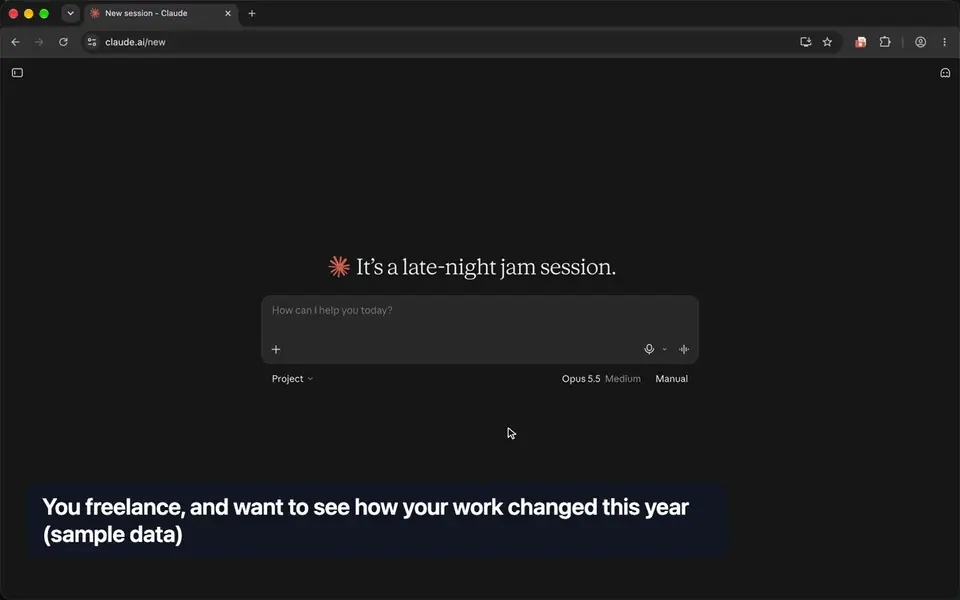

# Chronicle

A personal encyclopedia of your Claude.ai conversations — captured, summarized, and
made searchable from your own machine.

Chronicle takes the conversations you've had with Claude and turns them into a
durable, browsable record: every conversation gets a concise markdown summary, and
those summaries roll up into period entries (half-month → quarter → year). The whole
corpus is searchable, and an MCP server lets Claude itself read back through it — to
recall what you decided, quote what you actually said, or revisit old threads with
fresh eyes.



Everything runs locally. Your conversations never leave your machine except for the
summarization passes you explicitly run.

## How it works

Chronicle is three pieces that hand off to each other:

1. **The browser extension** (`extension/`) — a Chrome and Firefox extension that
   exports your Claude.ai conversation history (all of it, or a date-bounded slice)
   as a single JSON file.
2. **The pipeline** (`pipeline/`) — a Python CLI that ingests those exports, splits
   them into per-conversation files, tracks freshness from timestamps, and
   orchestrates Claude to write the summaries and period entries.
3. **The MCP server** (`pipeline/chronicle/mcp_server.py`) — exposes the processed
   archive to Claude Desktop as a set of search/read tools, so you can ask Claude to
   find, quote, and reflect on past conversations.

```
Claude.ai  ──(extension)──▶  export.json  ──(pipeline)──▶  summaries + entries  ──(MCP)──▶  Claude Desktop
```

## Quick start

### 1. Build and install the extension

```bash
./build.sh            # lints + builds the extension into artifacts/ (needs Node 20+)
```

One build runs in both browsers.

- **Chrome**: open `chrome://extensions`, turn on **Developer mode**, click **Load
  unpacked** and pick `artifacts/chrome/`. After a rebuild, click the reload arrow
  on the extension's card. From a release, unzip `chronicle_export-<version>-chrome.zip`
  and load that folder the same way.
- **Firefox** (127 or later): open `about:debugging` → **This Firefox** → **Load
  Temporary Add-on** and pick `artifacts/chronicle_export-<version>.zip` (or
  `extension/manifest.json` for a live-reload dev copy). Temporary add-ons are
  removed when Firefox quits.

Open `claude.ai`, sign in, and use the extension's toolbar popup to export your
history. It needs access to claude.ai, which both browsers grant at install. If you
turn it off later, Fetch says where to turn it back on: in Firefox, `about:addons` →
Chronicle Export → **Permissions**; in Chrome, the extension's **Details** →
**Site access**.

### 2. Set up the pipeline

```bash
uv venv                       # creates .venv/ (uses https://github.com/astral-sh/uv)
uv pip install -e ./pipeline
uv run chronicle --help
```

Python 3.11+; no third-party runtime dependencies. Drop an export into the inbox and
run the whole loop with one command:

```bash
uv run chronicle          # ingest the latest export, summarize everything stale, reindex
```

That's the default — bare `chronicle` brings the archive up to date (it calls Claude, so
it costs money; use `chronicle sync --ingest-only` for the free ingest, or `--dry-run` to
preview). Period rollups (half-month → quarter → year) are a separate step:
`chronicle syn`. See **[pipeline/README.md](pipeline/README.md)** for the full command
reference, directory layout, and freshness model.

### 3. (Optional) Wire up the MCP server

Install the MCP extra and point Claude Desktop at it:

```bash
uv pip install -e './pipeline[mcp]'
```

Add a server entry to Claude Desktop's `claude_desktop_config.json` that runs
`chronicle-mcp` (the `uv run --project ./pipeline chronicle-mcp` form works well).
Restart Claude Desktop to pick it up. The server exposes tools for finding
conversations, reading summaries and period entries, browsing index cards, mapping
recurring themes, and pulling verbatim passages.

## Security posture

Chronicle treats your conversation content as untrusted input (it's anything you've
ever pasted into Claude). Every `claude` invocation in the summarize/synthesize passes
runs with file-writing and shell tools disabled and a spend cap — the Python wrapper
is the only thing that writes files. Details in
[pipeline/README.md](pipeline/README.md#security-posture) and
`pipeline/chronicle/claude_invoke.py`.

## Layout

```
extension/    Chrome and Firefox extension — captures Claude.ai exports
pipeline/     Python CLI — ingest, summarize, synthesize, search, MCP server
files/        Summarization/synthesis prompts and the original design specs
features/     What a user can do, and the check for each
build.sh      Builds the extension; `check` runs the laws and drives
```

Processed data (your summaries, the search index, raw exports) lives outside version
control by design — see `.gitignore`.
